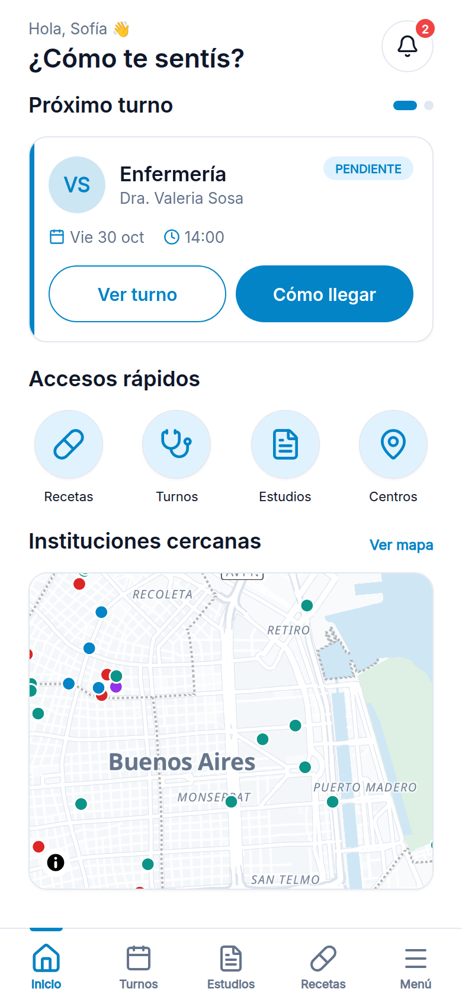
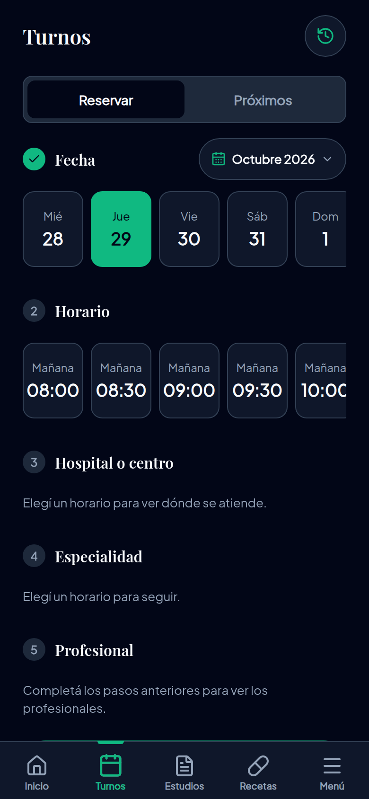

# DocApp Go

App móvil de **gestión de turnos y servicios médicos multi-hospital**. Trabajo práctico de
**Programación de Apps Móviles (UCA)**.

> No importa qué médico, hospital o laboratorio necesites: la app encuentra las opciones disponibles
> para vos **según tu plan médico** y te deja gestionar todo desde un mismo lugar.

El paciente no tiene que preguntarse "¿dónde atiende este médico?" ni "¿qué laboratorio acepta mi plan?":
la app cruza su cobertura con los hospitales, profesionales y horarios cargados, y le muestra solo lo que
puede usar. Los establecimientos son los reales de CABA, sacados del REFES (Registro Federal de
Establecimientos de Salud).

  
  &nbsp;&nbsp;&nbsp;
  

Inicio del paciente (modo claro) · Reserva de un turno (modo oscuro)

## Qué se puede hacer

La app tiene tres modos, y el rol lo define la cuenta con la que se ingresa (DNI + contraseña).

- **Paciente:** reservar turnos en cinco pasos (fecha → horario → hospital → especialidad → profesional),
  ver, cancelar y reprogramar los próximos turnos, ver los centros en un mapa, consultar órdenes,
  resultados de estudios (PDF) y recetas, recibir notificaciones y calificar a los profesionales después
  de la consulta.
- **Profesional de la salud:** se registra verificando su matrícula en el padrón nacional, carga dónde
  atiende, qué coberturas acepta y sus horarios, confirma o rechaza turnos y les asigna órdenes y recetas
  a sus pacientes.
- **Administrador:** ve métricas de uso y administra las obras sociales y las instituciones, con sus
  coberturas.

Tiene modo claro y modo oscuro, que se eligen en Menú → Configuración.

## Stack

React Native 0.86 + **Expo SDK 57** · TypeScript · Expo Router · mapa con MapLibre + OpenFreeMap. El
backend (Express + Prisma + SQLite) está en otro repo:
[docapp-go-backend](https://github.com/eduescuti/docapp-go-backend).

## Qué hay en este repo

| Carpeta | Contenido |
|---|---|
| [`frontend/`](frontend/) | La app. Cómo instalarla y correrla: [`frontend/README.md`](frontend/README.md). Cuentas de prueba: [`frontend/USUARIOS-DE-PRUEBA.md`](frontend/USUARIOS-DE-PRUEBA.md) |
| [`investigacion-apis/`](investigacion-apis/) | Investigación de fuentes de datos (hospitales, obras sociales, coberturas) y registro de la integración del mapa |
| [`mockup/`](mockup/) | Mockup interactivo del Sprint 1 |
| [`capturas/`](capturas/) | Las imágenes de este README |
